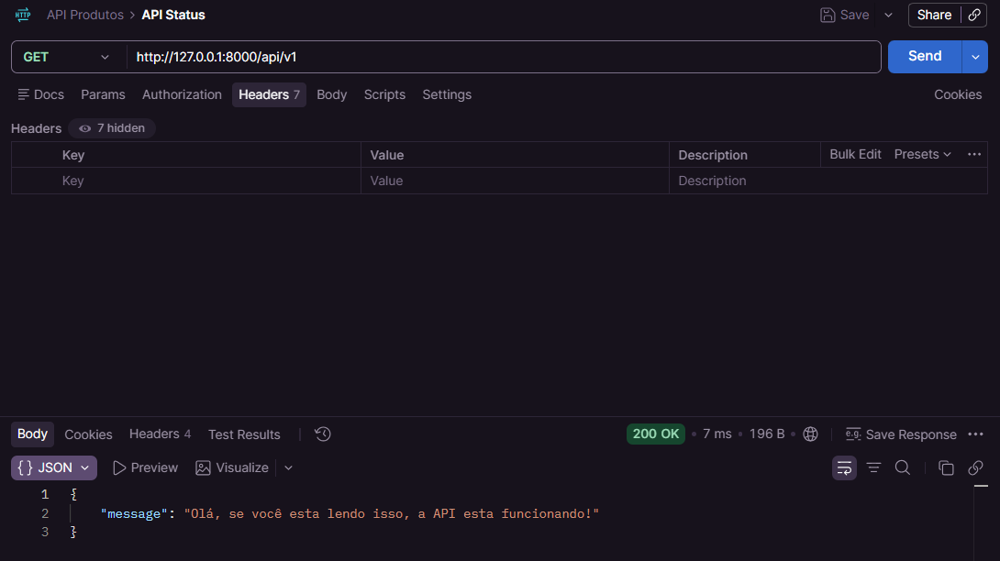
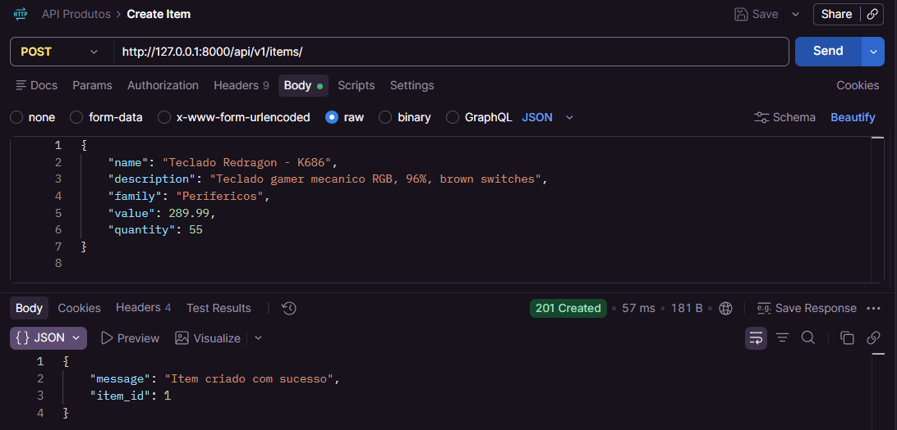
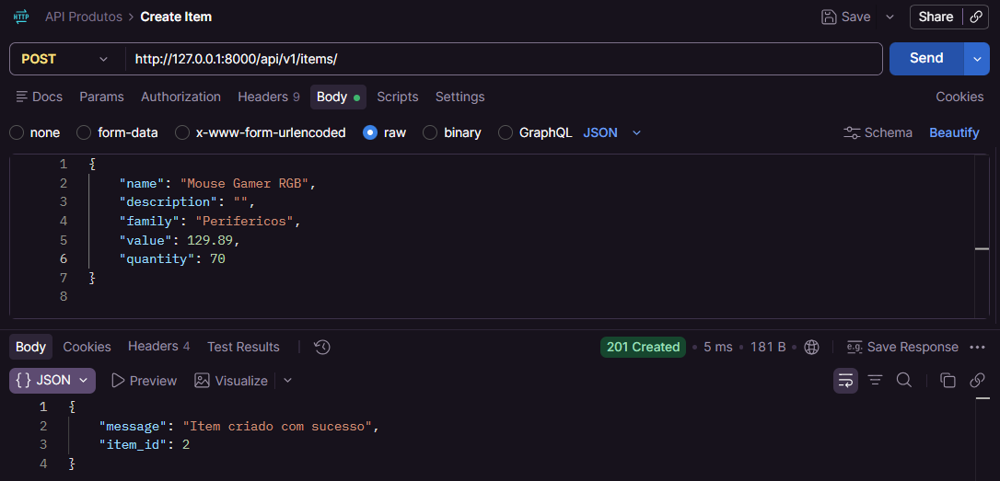
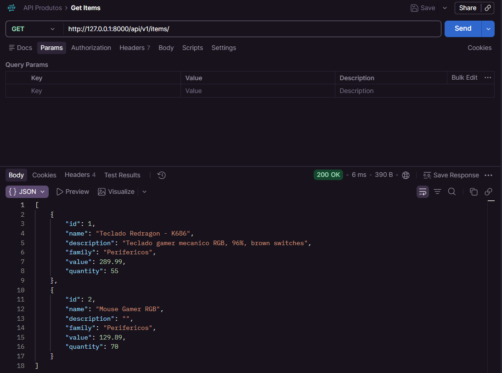
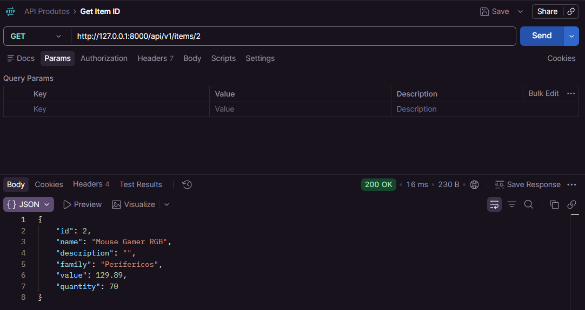
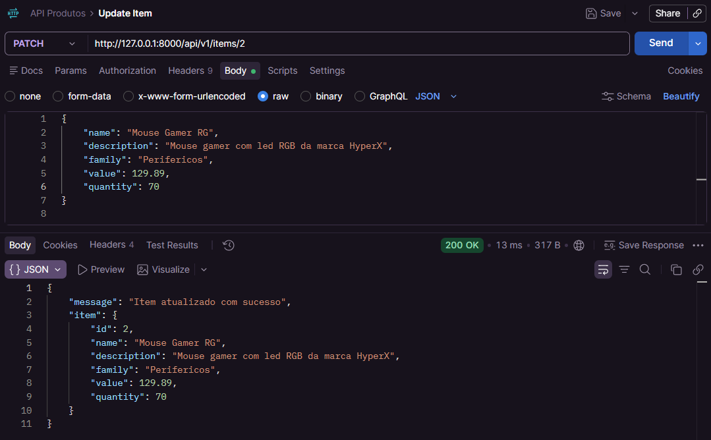
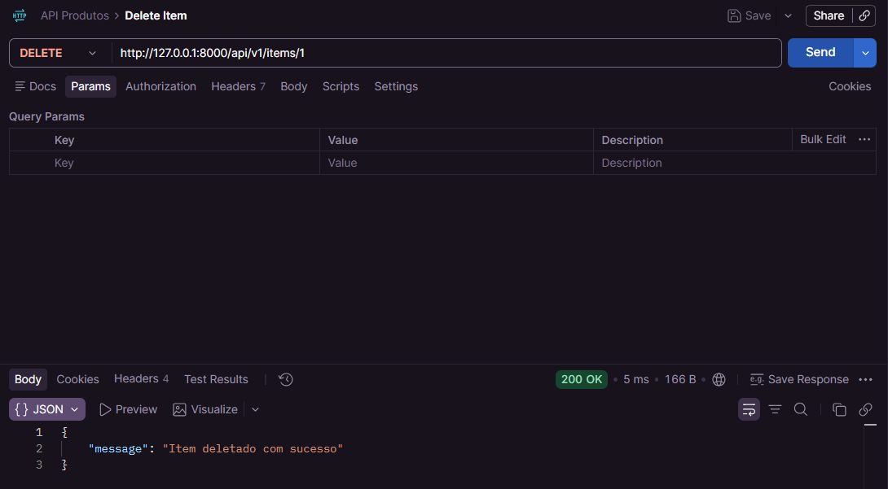
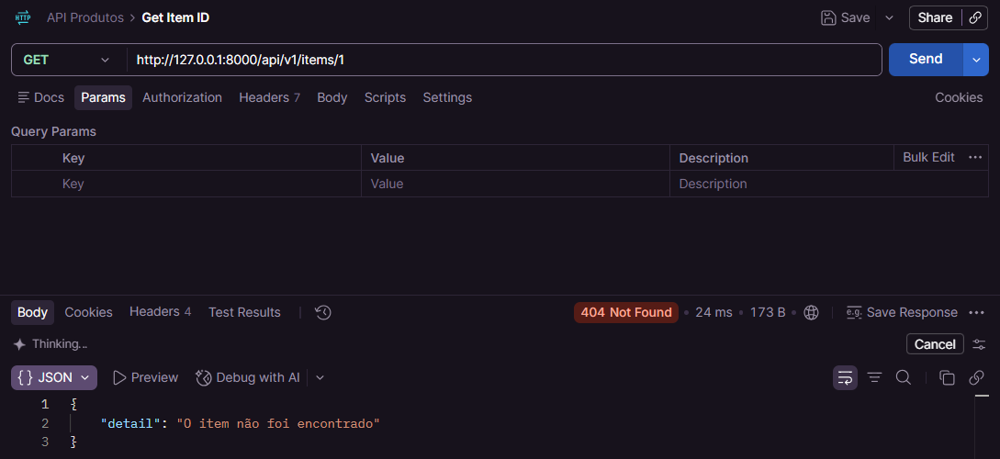

# 🚀 API-produtos *(Branch: feat/database)*

> **API REST desenvolvida em Python com FastAPI, criada como projeto de estudos para consolidar conceitos de Backend, arquitetura em camadas, validação de dados, regras de negócio e persistência relacional com SQLAlchemy e MySQL.**

<p align="center">
  
  
  
  
  
  
</p>

---

## 📌 Sobre o projeto

O **API-produtos** é uma API REST desenvolvida em Python utilizando o framework **FastAPI**.

Nesta etapa evolutiva (`feat/database`), o projeto transicionou para uma **base de dados relacional real (MySQL)**, utilizando **SQLAlchemy** como ORM e **PydanticSettings** para uma gestão robusta, tipada e centralizada das configurações e variáveis de ambiente.

O projeto foi criado com o objetivo de estudar e compreender, na prática, como uma aplicação **Backend** é estruturada, como uma requisição percorre suas diferentes camadas e como os dados são validados, processados e armazenados.

A aplicação utiliza uma arquitetura dividida em responsabilidades, separando:

- 🌐 **Routers** — responsáveis pelos endpoints e comunicação HTTP;
- 📋 **Schemas** — responsáveis pela estrutura, validação e serialização dos dados com Pydantic;
- ⚙️ **Services** — responsáveis pelas regras de negócio;
- 💾 **Repositories** — responsáveis pela persistência e comunicação com o banco relacional via ORM.

---

## 🎯 Objetivos de estudo

Durante o desenvolvimento, os principais objetivos foram:

- Compreender o funcionamento de uma **API REST**;
- Trabalhar com métodos HTTP e seus respectivos comportamentos;
- Estruturar uma aplicação Backend em diferentes camadas;
- Aprender a separar responsabilidades entre Router, Service e Repository;
- Utilizar **Pydantic** e **PydanticSettings** para validação, serialização e configuração;
- Implementar regras de negócio;
- Integrar a aplicação a um banco de dados relacional (MySQL) via **SQLAlchemy**;
- Criar respostas padronizadas para os endpoints;
- Desenvolver testes automatizados.

---

# 🏗️ Arquitetura da aplicação

A aplicação foi estruturada seguindo uma divisão de responsabilidades entre diferentes camadas.

```text
                         ┌──────────────────┐
                         │     CLIENTE      │
                         │ Postman / HTTP   │
                         └────────┬─────────┘
                                  │
                                  ▼
                         ┌──────────────────┐
                         │     ROUTERS      │
                         │ Endpoints / HTTP │
                         └────────┬─────────┘
                                  │
                                  ▼
                         ┌──────────────────┐
                         │     SCHEMAS      │
                         │ Pydantic / Dados │
                         └────────┬─────────┘
                                  │
                                  ▼
                         ┌──────────────────┐
                         │     SERVICES     │
                         │ Regras de negócio│
                         └────────┬─────────┘
                                  │
                                  ▼
                         ┌──────────────────┐
                         │   REPOSITORIES   │
                         │ SQLAlchemy / ORM │
                         └────────┬─────────┘
                                  │
                                  ▼
                         ┌──────────────────┐
                         │      MYSQL       │
                         │ Banco Relacional │
                         └──────────────────┘
```

### 🔄 Fluxo de uma requisição

De maneira simplificada, o fluxo da aplicação funciona da seguinte forma:

**1. Cliente**
O cliente envia uma requisição HTTP para um endpoint da API.

**2. Router**
O Router recebe a requisição, identifica o endpoint correspondente e encaminha os dados para as próximas camadas.

**3. Schema**
Os dados passam pelos modelos definidos com **Pydantic**, responsáveis por estruturar e validar as informações recebidas.

**4. Service**
A camada de Service aplica as regras de negócio da aplicação. É nesse ponto que são realizadas as validações e decisões relacionadas ao comportamento da operação.

**5. Repository**
O Repository utiliza o **SQLAlchemy (ORM)** para a manipulação e persistência dos dados no MySQL.

**6. Retorno**
Após a operação, o resultado retorna pelas camadas até chegar ao Router, que constrói a resposta HTTP para o cliente.

---

# 🛠️ Tecnologias utilizadas

| Tecnologia | Utilização |
|---|---|
| 🐍 **Python** | Linguagem principal |
| ⚡ **FastAPI** | Desenvolvimento da API REST |
| 🐬 **MySQL** | Banco de dados relacional |
| 🗄️ **SQLAlchemy** | ORM para mapeamento e persistência de dados |
| 📋 **Pydantic / Settings** | Validação, serialização e gestão de configuração |
| 🧪 **Pytest** | Execução dos testes automatizados |
| 📮 **Postman** | Testes funcionais e consumo manual da API |
| 🚀 **Uvicorn** | Servidor ASGI utilizado para executar a aplicação |

---

# 🚀 Como executar o projeto

## 📋 Pré-requisitos
Antes de iniciar, certifique-se de ter instalado em sua máquina:
- **Python** (versão 3.12 ou superior).
- **MySQL Server** (o banco de dados pode estar rodando localmente na sua máquina, hospedado de forma remota/nuvem, ou isolado dentro de um container Docker).

---

## 1. Clone o repositório e acesse a branch
```bash
git clone https://github.com/CordeiroGusta/API-produtos.git
cd API-produtos
git checkout feat/database
```

## 2. Crie e ative o ambiente virtual
### 🪟 Windows — PowerShell
```powershell
python -m venv .venv
.venv\Scripts\Activate.ps1
```
### 🪟 Windows — CMD
```cmd
python -m venv .venv
.venv\Scripts\activate.bat
```
### 🐧 Linux / 🍎 macOS
```bash
python3 -m venv .venv
source .venv/bin/activate
```

## 3. Instale as dependências
```bash
pip install -r requirements.txt
```

## 4. Crie o banco de dados (Schema)
O projeto disponibiliza um script automatizado (`scripts/create_database.sql`) para criar o banco de dados com codificação correta (`utf8mb4`). Você pode executá-lo de acordo com a sua preferência:

- **Via MySQL Workbench:**
  1. Abra o MySQL Workbench e conecte-se ao seu servidor.
  2. Vá em **File > Open SQL Script...** e selecione o arquivo `create_database.sql`.
  3. Clique no ícone do raio (⚡) para executar o script.

- **Via Linha de Comando (MySQL CLI):**
  No seu terminal e dentro da pasta do projeto, execute o comando abaixo informando seu usuário:
  ```bash
  mysql -u seu_usuario -p < scripts/create_database.sql
  ```

## 5. Configure as variáveis de ambiente
Crie um arquivo `.env` na raiz do projeto baseado no `.env.example`. Exemplo de configuração:

```env
DB_HOST=localhost
DB_PORT=3306
DB_NAME=products
DB_USER=seu_usuario_mysql
DB_PASSWORD=sua_senha_mysql
DB_DRIVER=mysql+pymysql
```

> **Nota de Engenharia & Docker:** 
> - O parâmetro `DB_DRIVER` externalizado permite que a aplicação seja totalmente agnóstica ao banco de dados, facilitando migrações futuras para outros dialetos SQL sem alterar o código-fonte.
> - Se você estiver rodando tanto a API quanto o MySQL em **containers Docker**, garanta que ambos estejam conectados à mesma rede Docker. Nesse cenário, o `DB_HOST` no seu `.env` deve apontar para o **nome do serviço do container MySQL** (ex: `DB_HOST=mysql_db`) em vez de `localhost`.

## 6. Inicie a API
```bash
python -m uvicorn app.main:app --reload
```

Após iniciar o servidor, a API estará disponível em `http://127.0.0.1:8000` (com base em `/api/v1`).

---

# 📮 Testando a API com Postman

Além dos testes automatizados, o projeto possui uma **coleção do Postman em formato JSON dedicada à API**.

### 📂 Coleção
A coleção está disponível no projeto em:
```text
postman/
└── API-produtos.postman_collection.json
```

### 📥 Como importar
No Postman: `Import` -> Selecionar o arquivo JSON -> `API-produtos.postman_collection.json` -> `Import`.

---

# 🧪 Demonstração do CRUD

A seguir está uma demonstração do funcionamento da API através do Postman, cobrindo o fluxo completo: criação, consulta, consulta individual, atualização e exclusão.

## 🟢 Verificando se a API está funcionando
<p align="center">
  
</p>

## ➕ Criando itens — POST
<p align="center">
  
</p>
<p align="center">
  
</p>

## 🔎 Consultando os itens — GET
<p align="center">
  
</p>

## 🔍 Consultando um item específico — GET /{id}
<p align="center">
  
</p>

## ✏️ Atualizando um item — PATCH
<p align="center">
  
</p>

## 🗑️ Deletando itens — DELETE
<p align="center">
  
</p>

## 🚫 Consultando um recurso deletado
<p align="center">
  
</p>

---

# 🧪 Testes automatizados

A aplicação possui uma suíte robusta de **testes automatizados** cobrindo os módulos da arquitetura (Routers, Services e Repositories).

## ▶️ Executando os testes
Com o ambiente virtual ativado e as dependências instaladas, execute:
```bash
pytest -v
```

---

# 📚 Principais aprendizados

Este projeto foi desenvolvido principalmente como uma forma de **aprender Backend através da prática**. Ao longo da construção da API, foram consolidados conhecimentos sobre APIs REST, arquitetura em camadas, validação de dados com Pydantic, persistência relacional com SQLAlchemy, testes automatizados e testes funcionais.
